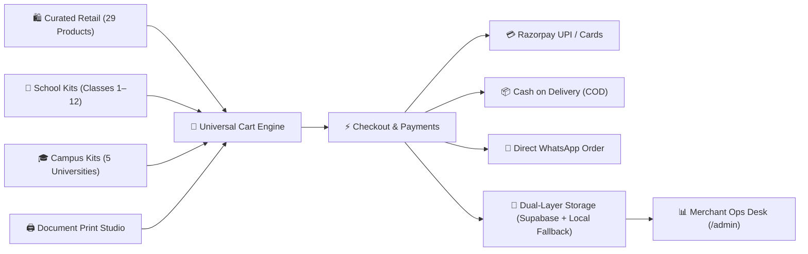

# PAPR — Make room for ideas.
> **Stationery · Essentials · Print**  
> *Pronunciation: Paper (/ˈpeɪ.pər/)*

[](https://react.dev/)
[](https://tanstack.com/)
[](https://tailwindcss.com/)
[](https://www.typescriptlang.org/)
[](https://supabase.com/)
[](https://razorpay.com/)
[](https://github.com/shreyanshsharma-1210/Papr)
[](https://eslint.org/)

---

## ✦ Overview

**PAPR** is a bold, contemporary stationery-commerce platform and operational fulfillment desk designed for university students, school communities, creative professionals, and modern workspaces.

Moving away from sterile, cookie-cutter online stores, PAPR embraces an **Offbeat Creative Commerce** identity—merging tactile paper sensibilities, vibrant industrial palettes, and robust full-stack engineering to power academic bundle fulfillment, on-demand document bindery, and daily stationery retail.

---

## ✦ Key Highlights & Innovation



### 1. Curated Everyday Catalogue (`/shop`)
- **29 Curated Products:** Fine Japanese pens, heavy GSM spiral notebooks, drafting tools, desk organizers, and high-performance adhesives.
- **Matched High-Res Photography:** 100% matched, authentic product photography with high-speed progressive compression (**reduced from 78.5 MB to 2.27 MB, a 97.1% bandwidth optimization**).
- **Interactive Multi-Filter:** Live search, category tabs, price range filters, stock state, and same-day dispatch toggles.

### 2. Syllabus-Verified School Class Kits (`/class-kits`)
- **Classes 1 through 12:** Complete academic year kits tailored for Indian school curricula (CBSE/ICSE/State boards).
- **Senior Secondary Academic Streams:** Class 11 & 12 kits dynamically branch into **Science**, **Commerce**, and **Humanities / Arts**.
- **Customizable Bundle Overrides:** Essential textbooks are pinned with required locks, while optional stationery items (notebooks, pens, geometry tools) feature quantity adjusters that automatically compute an **8% bundle discount**.

### 3. University Campus Kits (`/college-kits`)
- **Customized for Top Indian Campuses:**
  - Delhi Technological University (**DTU**)
  - Netaji Subhas University of Technology (**NSUT**)
  - Indian Institute of Technology Delhi (**IIT Delhi**)
  - University of Delhi North Campus (**DU**)
  - Jamia Millia Islamia (**JMI**)
- **4-Step Wizard:** Select College &rarr; Department (Computer Science, Mechanical, Architecture, Economics, Design) &rarr; Year of Study (1st to 4th Year) &rarr; Customized Bundle with **10% campus discount**.
- **Custom Kit Requests:** Interactive modal for students from unlisted institutions to submit semester syllabi for instant curation.

### 4. Interactive Print Studio & Bindery (`/printing`)
- **Instant Client-Side Document Calculation:** Upload PDF/DOC files (up to 25 MB) with automatic page-count estimation.
- **Fine-Grained Print Configuration:**
  - **Paper Stock:** Standard 75 GSM vs. Premium 100 GSM Bond.
  - **Print Mode:** Black & White (₹1.50/page) vs. High-Fidelity Full Colour (₹6.00/page).
  - **Print Sides:** Single-Sided vs. Duplex (automatic 20% duplex paper savings).
  - **Finishing & Binding:** Corner Stapled, Spiral Coil Bound, Soft Thermal Bound, or Gold-Foil Embossed Thesis Hardbound.
- **Transparent Live Pricing:** Real-time cost updates as specifications change.

### 5. Seamless Multi-Channel Checkout (`/checkout`)
- **Online Payments:** Integrated [Razorpay](https://razorpay.com/) payment modal supporting UPI (Google Pay, PhonePe, Paytm), Credit/Debit Cards, and Netbanking.
- **Cash on Delivery (COD):** Zero-friction offline payment mode for campus hostel deliveries.
- **WhatsApp Direct Order:** Single-click order payload generation formatted cleanly for instant merchant fulfillment via WhatsApp.
- **PIN Code Auto-Detection:** Indian postal code lookup automatically verifying same-day delivery eligibility across Delhi-NCR.

### 6. Merchant Ops Desk & Admin Management (`/admin`)
- **Executive KPI Dashboard:** Real-time metrics for total revenue, active orders, pending print jobs, and catalogue stock health.
- **Live Order Fulfillment:** Comprehensive order queue with instant status updates (`New` &rarr; `Processing` &rarr; `Printed` &rarr; `Dispatched` &rarr; `Delivered`).
- **Catalogue Inventory Manager:** Full CRUD interface to add new products, update prices, modify descriptions, and toggle in-stock status.
- **Print Job Queue:** Direct PDF download links and full specification inspection (paper stock, binding, duplex mode) for print operators.
- **B2B Bulk Procurement Requisitions:** Track and respond to institutional wholesale inquiries.

### 7. Dual-Layer Resilient Storage Architecture
- **Supabase PostgreSQL with RLS:** Enterprise relational database with Row Level Security policies for production deployments.
- **Zero-Config Client Storage Fallback:** If Supabase credentials are not provided or the network is offline, PAPR automatically transitions to a persistent `localStorage` database. Demonstrations, portfolio walkthroughs, and offline testing never fail or crash.

---

## ✦ Brand Identity & Visual System

PAPR uses a custom **Offbeat Creative Commerce** design system built directly on Tailwind CSS v4 design tokens:

| Color Token | Hex Code | Visual Application |
|---|---|---|
| **Deep Plum** | `#302033` | Brand identity, typography, navigation headers, dark surfaces |
| **Paper White** | `#F7F5EF` | Primary page canvas, card backgrounds, crisp content surfaces |
| **Acid Lime** | `#D7F05A` | Primary CTA buttons, interactive hover states, active category tabs |
| **Persimmon** | `#F16A45` | Sale badges, urgent order alerts, bundle discount indicators |
| **Soft Lilac** | `#C9B9E8` | Category card backdrops, secondary highlight tags |
| **Butter Yellow**| `#F3E6A2` | Curated product highlights, student kit banners |

### Typography
- **Headings & Editorial Titles:** `Space Grotesk` & `Plus Jakarta Sans`
- **Body, Pricing & UI Controls:** `DM Sans` & `Inter`
- **Technical & Print Specs:** Monospace font stacks (`Fira Code`, `JetBrains Mono`)

### Micro-Interactions & Loading Animations
- **LogoLoader (`<LogoLoader />`):** Custom branded loader featuring a Deep Plum tile, pulsing Acid Lime "P", bouncing Persimmon accent dot, and dual counter-rotating orbit glow rings. Supports `fullscreen`, `card`, `overlay`, and `inline` variants.
- **NavigationProgressBar (`<NavigationProgressBar />`):** 1px top-pinned viewport progress bar with a gradient glow (`Acid Lime` &rarr; `Persimmon`) dynamically triggered during route transitions via TanStack Router.

---

## ✦ Tech Stack

| Layer | Technology | Purpose |
|---|---|---|
| **Runtime & Language** | [TypeScript 5.9](https://www.typescriptlang.org/) + [Node.js](https://nodejs.org/) | Type-safe development across client and server |
| **Frontend Framework** | [React 19.2](https://react.dev/) | Concurrent React with latest Action hooks |
| **Routing & SSR** | [TanStack Start](https://tanstack.com/start) & [Router](https://tanstack.com/router) | Type-safe file-based routing and SSR hydration |
| **Styling** | [Tailwind CSS v4](https://tailwindcss.com/) + `@tailwindcss/vite` | OKLCH modern CSS engine with custom `@theme` |
| **State Management** | [Zustand v5](https://github.com/pmndrs/zustand) | Cart and session state with persistent hydration |
| **Database & Auth** | [Supabase](https://supabase.com/) (PostgreSQL 15) | Relational database, Auth, and Storage |
| **Payments** | [Razorpay](https://razorpay.com/) Web SDK | Indian UPI, QR, Card, and Netbanking payments |
| **Icons & Notifications** | [Lucide React](https://lucide.dev/) + [Sonner](https://sonner.emilkowal.ski/) | SVG iconography and high-performance toast notifications |
| **Build & Bundler** | [Vite 7](https://vitejs.dev/) | Lightning-fast HMR and optimized production bundling |
| **Testing** | Node.js Test Runner + `tsx` | Automated business logic and kit calculation tests |

---

## ✦ Getting Started

### 1. Prerequisites
- **Node.js:** `v20.x` or `v22.x+` (verified on Node 20 / 22 / 24)
- **Package Manager:** `npm` (v10+)

### 2. Clone Repository
```bash
git clone https://github.com/shreyanshsharma-1210/Papr.git
cd Papr
```

### 3. Install Dependencies
```bash
npm install
```

### 4. Configure Environment
Copy the example environment template:
```bash
cp .env.example .env
```

Edit `.env` with your Supabase and Razorpay credentials (optional—PAPR will run in resilient local mock mode if omitted):
```env
# Supabase Configuration
SUPABASE_URL=https://your-project.supabase.co
SUPABASE_PUBLISHABLE_KEY=your-supabase-anon-key
VITE_SUPABASE_URL=https://your-project.supabase.co
VITE_SUPABASE_PUBLISHABLE_KEY=your-supabase-anon-key

# Razorpay Test Gateway
RAZORPAY_KEY_ID=rzp_test_your_key_id
VITE_RAZORPAY_KEY_ID=rzp_test_your_key_id

# App Host
VITE_APP_URL=http://localhost:8080
```

### 5. Run the Local Development Server
```bash
npm run dev
```
Open [http://localhost:8080](http://localhost:8080) to explore the application.

---

## ✦ Database Setup & Migrations

If you are connecting your own Supabase project:
1. Open your [Supabase Dashboard](https://supabase.com/dashboard) and navigate to **SQL Editor**.
2. Run [`supabase/migrations/20261114_initial_schema.sql`](./supabase/migrations/20261114_initial_schema.sql) to create tables (`products`, `orders`, `order_items`, `print_jobs`, `bulk_quotes`, `profiles`) and Row-Level Security policies.
3. Run [`supabase/migrations/20261114_seed_data.sql`](./supabase/migrations/20261114_seed_data.sql) to seed the 29 curated stationery products, school kits, and college bundles.

---

## ✦ Testing & Code Quality

### Automated Unit Tests
PAPR includes a test suite covering all commercial calculations, bundle discounts, custom kit overrides, and delivery thresholds:
```bash
npm test
```
```text
✔ should find valid products in catalogue
✔ should calculate Class 1 kit bundle with 8% discount
✔ should adjust Class Kit price when optional items are overridden
✔ should calculate College Kit with 10% campus discount
✔ should calculate correct line prices across all cart line types
✔ should calculate free shipping above ₹499 threshold
ℹ tests 6 | suites 1 | pass 6 | fail 0
```

### Code Formatting & Static Analysis
```bash
# Type check all TypeScript source files
npx tsc --noEmit

# Run ESLint across entire repository
npm run lint

# Production build test
npm run build
```

---

## ✦ Project Structure

```text
papr/
├── public/                       # Static public assets
│   ├── images/products/          # Optimized Web-scale product photography (900px, mozjpeg)
│   ├── favicon.ico               # Branded icon
│   └── placeholder.svg
├── src/
│   ├── components/               # Reusable UI components
│   │   ├── Logo.tsx              # Dynamic PAPR brand logo
│   │   ├── LogoLoader.tsx        # Branded animated loader (fullscreen, card, overlay, inline)
│   │   ├── NavigationProgressBar.tsx # Top viewport transition progress bar
│   │   ├── ProductImage.tsx      # High-performance image with loading skeleton & zero CLS
│   │   ├── Header.tsx            # Sticky navigation bar with cart badge & mobile menu
│   │   ├── Footer.tsx            # Brand footer with quick links & store details
│   │   └── WhatsAppFab.tsx       # Floating WhatsApp quick order trigger
│   ├── integrations/supabase/    # Supabase PostgreSQL client & types
│   │   ├── client.ts             # Browser client with resilient environment lookup
│   │   ├── client.server.ts      # Server-side client for SSR operations
│   │   └── types.ts              # Strongly-typed database schema contracts
│   ├── lib/                      # Core business logic, storage & utilities
│   │   ├── calculations.test.ts  # Commercial calculation unit tests
│   │   ├── cart-store.ts         # Zustand cart state with local persistence
│   │   ├── db-service.ts         # Hybrid Supabase + localStorage persistence engine
│   │   ├── mock-data.ts          # Complete product catalog & kit definitions
│   │   ├── product-images.ts     # Curated 1-to-1 photographic asset mappings
│   │   ├── razorpay.ts           # Razorpay SDK loader & transaction utilities
│   │   └── types.ts              # Domain interfaces (Product, Kit, Order, PrintSpecs)
│   ├── routes/                   # TanStack Router type-safe file routes
│   │   ├── __root.tsx            # Root layout with navigation & progress bar
│   │   ├── index.tsx             # Homepage & brand editorial showcase
│   │   ├── shop.tsx              # Product catalogue with live filters & search
│   │   ├── class-kits.index.tsx  # School kit browser (Classes 1–12)
│   │   ├── class-kits.$classId.tsx # Class kit customizer with bundle pricing
│   │   ├── college-kits.index.tsx # 4-step university kit wizard
│   │   ├── college-kits.$kitId.tsx # University kit customizer
│   │   ├── printing.tsx          # Print Studio & instant bindery calculator
│   │   ├── office.tsx            # Corporate desk tools & B2B bulk quote modal
│   │   ├── cart.tsx              # Shopping cart with WhatsApp export
│   │   ├── checkout.tsx          # Multi-payment checkout (Razorpay + COD)
│   │   ├── orders.tsx            # Customer order history & GST tax invoices
│   │   ├── profile.tsx           # User authentication & account management
│   │   └── admin.tsx             # Merchant Operations Desk & fulfillment CRM
│   ├── router.tsx                # TanStack Router configuration with prefetch
│   └── styles.css                # Tailwind CSS v4 theme variables & utilities
├── supabase/migrations/          # Relational SQL schema & seed migrations
├── .env.example                  # Environment variable reference template
├── eslint.config.js              # ESLint 9 flat configuration
└── package.json                  # Dependencies & npm scripts
```

---

## ✦ Commercial Features at a Glance

- [x] **29 Curated Products** across Writing, Paper, Tools, Office & Art.
- [x] **School Kits for Classes 1–12** with dynamic Senior Secondary Stream splitting (Science / Commerce / Arts).
- [x] **College Semester Bundles** for DTU, NSUT, IIT Delhi, DU North Campus, and Jamia Millia Islamia.
- [x] **Document Print Studio** with instant file page-count analysis and binding customization.
- [x] **Integrated Razorpay Payments** with full UPI and card checkout.
- [x] **Zero-Crash Resilient Architecture** (Supabase cloud database with automatic offline localStorage fallback).
- [x] **Full Merchant Admin Desk** with live order fulfillment, inventory CRUD, and print queue management.
- [x] **Production Performance Optimization**: 97.1% asset reduction, zero layout shift (CLS = 0), and preloaded navigation links.

---

## ✦ License

Built with pride by [Shreyansh Sharma](https://github.com/shreyanshsharma-1210).  
Licensed under the [MIT License](LICENSE).
